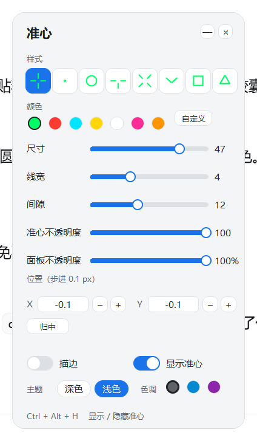

# 准心 Overlay · Crosshair Overlay

一个轻量的 Windows 屏幕准心工具。**不注入游戏进程、不读写游戏内存**，只是一个独立置顶窗口。

A lightweight screen crosshair for Windows. **No DLL injection, no memory reading** — it is just a separate always-on-top window.




---

## ⚠️ 使用前必读 / Read Before Use

**本项目只是绘图工具，是否允许使用取决于你玩的游戏。**

- 很多游戏（尤其实时对战 FPS）的**用户协议禁止外部准星**，因为部分武器存在腰射散布，叠加准星可能构成不公平优势。
- 使用前请自行确认目标游戏的 EULA / 社区规则；**职业赛事与部分平台一律禁止**。
- 因使用本工具导致的**封号、数据损失、比赛判负等后果，与本项目作者无关**。
- 本项目**不提供任何绕过反作弊的功能**，也不打算提供。

**This tool only draws pixels. Whether it is allowed depends on the game you play.** Check the game's EULA first. Use at your own risk.

---

## 功能 / Features

- **8 种准心样式**：十字、圆点、圆环、T 形、X 形、人字、方框、三角
- **7 种预设颜色** + 自定义取色
- 尺寸、线宽、间隙、不透明度独立可调
- **位置精度 0.1 px**，可微调与一键归中
- 深色 / 浅色主题，3 种强调色，切换带淡入淡出
- 面板可收起为小胶囊，减少遮挡
- 全局热键 `Ctrl + Alt + H` 显示 / 隐藏准心
- 配置自动保存，下次启动恢复上次状态
- 圆角、圆点全部由 PIL 超采样生成，无锯齿

## 系统要求 / Requirements

- Windows 10 1809 或更高（Windows 11 亦可）
- 需要 Python 3.9+（仅源码运行方式）
- 依赖：`pillow`、`numpy`（tkinter 为 Python 自带）

## 运行 / Run

### 方式一：直接运行源码

```bash
pip install pillow numpy
python src/crosshair.py
```

### 方式二：自行打包 exe

```powershell
powershell -ExecutionPolicy Bypass -File tools/build.ps1
```

产物在 `dist/准心/准心.exe`。打包脚本使用 `--onedir` 模式（**不要用 `--onefile`**，自解压包会被安全软件反复扫描，启动明显变慢甚至卡死）。

## 热键 / Hotkeys

| 热键 | 作用 |
|---|---|
| `Ctrl + Alt + H` | 显示 / 隐藏准心 |

其余操作都在面板里点击完成。

## 使用限制 / Known Limitations

- **独占全屏（Exclusive Fullscreen）下不显示**。请把游戏改成「无边框窗口」或「窗口化全屏」。
- 准心绘制在游戏画面之上，**不参与游戏渲染**，所以不受游戏内分辨率缩放影响。
- 部分带内核级反作弊的游戏（如 Vanguard）可能限制所有叠加层；这种情况请勿使用。
- 仅支持单一显示器的主屏居中或自定义偏移。

## 配置 / Configuration

配置保存在程序同目录的 `crosshair.json`。便携使用：整个文件夹拷走即可。

```json
{
  "style": "cross", "color": "#00FF66",
  "size": 47, "thick": 4, "gap": 12,
  "opacity": 100, "outline": false,
  "dx": -0.1, "dy": -0.1,
  "theme": "light", "panel_alpha": 1.0
}
```

## 实现要点 / How It Works

- 准心层用 `UpdateLayeredWindow` 做**逐像素 alpha**，边缘平滑。
- 控制面板用 Tk + `-transparentcolor` 色键实现圆角。
  注意：色键**无法处理半透明像素**，抗锯齿边缘会与近黑色键混合成黑点，所以面板背景采用**硬边**渲染（alpha 仅 0/255）。
- 窗口定位直接操作 `TkTopLevel`，绕开 Tk 在 150% 缩放下的坐标双重换算。

## 许可 / License

[MIT](LICENSE)

## 致谢 / Credits

图标与界面由 PIL 程序化绘制，无第三方素材。
